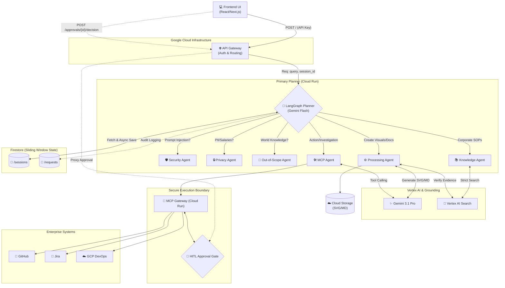

# Enterprise Assistant 🛡️
**By Team Tech Titans | AI Builder Cup 2026**

Enterprise Assistant is a strictly grounded, multi-agent enterprise orchestrator. It bridges the gap between static corporate knowledge bases and active engineering workflows. Featuring zero-hallucination architecture, instant sliding-window memory, and Human-in-the-Loop (HITL) DevOps approvals, TitanWork is built for secure, enterprise-grade AI execution.

## 🌟 Key Features

*   **Zero-Hallucination Guardrails:** Utilizes a custom LangGraph Planner to enforce strict routing. Requests for general world knowledge, prompt injections, or private data are blocked instantly.
*   **Grounded Visual Architecture:** Generates high-quality, infinitely scalable SVG Mermaid diagrams and markdown documents *only* if the facts exist in the Vertex AI Search corpus.
*   **Human-in-the-Loop (HITL) DevOps:** Integrates with an isolated MCP Gateway to safely execute GitHub, Jira, and DevOps operations, catching destructive actions (like production rollbacks) with an HTTP 202 Approval state.
*   **0ms Latency Memory:** Uses Cloud Firestore for a "Sliding-Window" conversation context, rewriting user pronouns (e.g., "draw a diagram of *it*") in a single LLM pass before hitting downstream agents, saving seconds of execution time.

## 🏗️ Architecture

Enterprise Assistant leverages Google Cloud Run, API Gateway, LangGraph, and Vertex AI.



## 📁 Repository Structure

```text
TechTitans-EnterpriseAssistant/
├── frontend/                   # UI for the Enterprise Work Agent
├── backend/
│   ├── orchestrator/           # LangGraph Planner & Agent Nodes (main.py)
│   └── mcp-gateway/            # Tool execution & HITL approval logic
├── infrastructure/             # API Gateway YAML configurations
└── docs/                       # Architecture diagrams and sample prompts
```

## 🚀 How to Test
1. Set the API URL to our Gateway endpoint.
2. Provide your API Key in the UI settings.
3. Use the prompts outlined in `docs/sample_prompts.md` to see the multi-agent routing in action!
