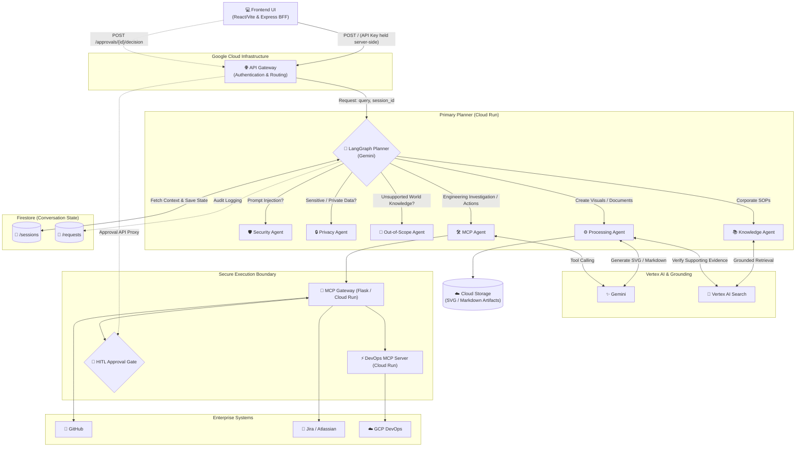

# Enterprise Assistant 🛡️
**By Team Tech Titans | AI Builder Cup 2026**

Enterprise Assistant is a strictly grounded, multi-agent enterprise orchestrator that bridges the gap between static corporate knowledge bases and active engineering workflows. Featuring grounded AI guardrails, sliding-window conversation memory, and Human-in-the-Loop (HITL) DevOps approvals, Enterprise Assistant is designed for secure, enterprise-grade AI execution.

## 🌟 Key Features

* **Grounded AI Guardrails:** Utilizes a custom LangGraph Planner to enforce strict routing. Requests involving prompt injection, sensitive private data, or unsupported general-world knowledge are blocked or handled according to the application's security policies.
* **Grounded Visual Architecture:** Generates scalable SVG Mermaid diagrams and Markdown documents only when supporting facts can be verified against the Vertex AI Search corpus.
* **Human-in-the-Loop (HITL) DevOps:** Integrates with an isolated Model Context Protocol (MCP) Gateway to safely execute GitHub, Jira, and DevOps operations. High-risk actions, such as production rollbacks, require explicit approval through a Firestore-backed approval workflow.
* **Secure Production Rollbacks:** Supports controlled DevOps workflows, including investigating a failed `payment-service` deployment running `v2.4.1` and requesting approval to roll back to the stable `v2.4.0` version. Approval requests use HTTP `202 Accepted` to indicate that the operation requires further processing.
* **Sliding-Window Conversation Memory:** Uses Cloud Firestore to maintain recent conversation context and resolve follow-up references (e.g., "draw a diagram of it") before routing requests to downstream agents.
* **Secure API Integration:** Uses Google Cloud API Gateway and an Express Backend-for-Frontend (BFF) to proxy frontend requests securely. Sensitive API keys are managed server-side through Google Secret Manager rather than exposed in browser code.

## 🏗️ Architecture

Enterprise Assistant leverages Google Cloud Run, API Gateway, LangGraph, Vertex AI, Vertex AI Search, Cloud Firestore, Cloud Storage, and dedicated backend microservices.



## 📁 Repository Structure

```text
TechTitans-EnterpriseAssistant/
├── README.md
├── frontend/                   # React/Vite UI & Express BFF
│   ├── src/                    # UI components, session memory, Markdown/Mermaid
│   ├── server.js               # Express proxy server & Cloud Run entry point
│   ├── deploy.sh               # Frontend deployment script
│   └── cloudbuild.yaml         # Google Cloud Build configuration
├── backend/
│   ├── orchestrator/           # LangGraph Planner & Agent Nodes (main.py)
│   ├── mcp-gateway/            # Tool execution policies & HITL approval logic
│   │   ├── gateway/            # Gateway, policy, provider and approval modules
│   │   ├── Dockerfile
│   │   ├── requirements.txt
│   │   └── deploy.sh
│   └── devops-mcp/             # Custom DevOps MCP Server
│       └── server/              # FastMCP application logic and state
├── infrastructure/             # API Gateway & Cloud Run configurations
└── docs/                        # Architecture diagrams and sample prompts
```

## 💻 Frontend Development

The frontend uses React and Vite, served through an Express Backend-for-Frontend (BFF). The BFF forwards API requests to the API Gateway while keeping sensitive configuration on the server.

### Run Locally

```bash
cd frontend
npm install
npm run dev
```

Ensure the frontend and Express BFF are configured to use the appropriate local endpoints for API requests.

## 🧪 How to Test

1. Configure the frontend BFF with the API Gateway endpoint.
2. Configure the required API key through Google Secret Manager and make it available to the server-side BFF.
3. Launch Enterprise Assistant and submit a corporate knowledge or engineering workflow query.
4. Use the prompts in `docs/sample_prompts.md` to test multi-agent routing and grounded responses.
5. Query the deployment status of `payment-service` to investigate the simulated production failure.
6. Request a rollback from `v2.4.1` to `v2.4.0` and verify that the operation enters the HITL approval workflow.
7. Approve or reject the pending request through the approval interface.
8. Verify the resulting deployment status and approval outcome.

## 🔐 Security Considerations

* **Server-Side Secrets:** Never expose API Gateway keys or other sensitive credentials in frontend JavaScript or client-side environment variables.
* **IAM Protection:** Keep backend Cloud Run services protected by IAM and grant only the permissions required for each service.
* **Approval Enforcement:** Require explicit approval for high-risk operations such as production rollbacks.
* **Approval Integrity:** Validate approval expiry, request status, and argument integrity before executing sensitive operations.
* **Auditability:** Maintain appropriate request and approval records in Firestore to support workflow traceability.
* **Grounded Responses:** Use Vertex AI Search as the source of enterprise knowledge and supporting evidence for generated content.

---

**Built by Team Tech Titans | AI Builder Cup 2026**
